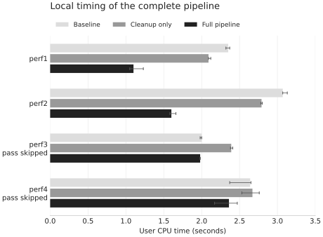

I recently (by recently, I mean about two weeks ago—midterms are finally done) implemented **frequent path loop invariant code motion** (FPLICM) in LLVM for my grad compiler class (CSE 583).

I started by moving loads out of loops, then tried moving the calculations that used them. I assumed that doing less work inside the loop would make the program faster.

Even though the output still matched, an early run of the first benchmark went from 2.32 seconds to 3.95 seconds of user CPU time.

This led me down a rabbit hole where I found repeated work I'd overlooked: moving the cached result around the loop.

## A billion iterations and ten updates

The first performance benchmark runs a loop a billion times, but assigns a new random index to `j` only ten times, starting at iteration zero. Here's a simplified version, with `F(j)` standing for a pure expression over initialized arrays:

```c
int j = 5;
for (int i = 0; i < N; ++i) {
    B[i % M] = F(j) + i;
    if (rare_update(i))
        j = next_index();
}
```

I'd like to compute `F(j)` once and reuse it, but ordinary LICM has to account for the store to `j`. Its loaded value isn't invariant, and neither is the expression depending on it.

Frequent path LICM lets us cache the result across iterations where `j` stays the same, then recompute it after an update. Ignoring the safety checks for a moment, it looks like this:

```c
int j = 5;
double cached = F(j);
for (int i = 0; i < N; ++i) {
    B[i % M] = cached + i;
    if (rare_update(i)) {
        j = next_index();
        cached = F(j);
    }
}
```

The rare branch still executes normally, with repair work after the store. If the profile predicts poorly, the extra repairs may hurt performance, but they must still preserve behavior.

Moving a chain of divisions offers more savings than moving one load. But keeping the result available across iterations can add work of its own, even when the value never changes.

## Finding the frequent path

For the mandatory load-only pass, I used `LoopInfo` and `BranchProbabilityInfo` from LLVM's function analysis manager. Each top-level loop needed a preheader: the block outside it where I'd put the initial load. LLVM's [loop terminology documentation](https://releases.llvm.org/22.1.0/docs/LoopTerminology.html) defines these blocks precisely.

From the header, I followed successors with an edge probability of at least 80% until I reached the backedge. If there was no qualifying edge, the walk left the loop, or it revisited a block other than the header, I discarded the path.

The 80% threshold applies to each edge, not to the probability of the entire path.

For each non-atomic, non-volatile load on that path, I checked that its address was loop invariant. The assignment lets us ignore pointer aliasing, so I scanned for stores to that exact address. A frequent-path store disqualified the load; an infrequent store identified a repair location. I required at least one infrequent store, since the assignment focused on almost-invariant loads, and checked that the load could execute safely in the preheader.

The **address** and **value** are separate here. The stack slot for `j` exists outside the loop while stores inside it change the contents. I need the fixed address to move the load and the store locations to repair its result.

## The repair has to preserve the old value too

LLVM uses static single assignment form: each SSA value has one definition. My cached value could come from the preheader load or a repair load. A [PHI node](https://releases.llvm.org/22.1.0/docs/LangRef.html#phi-instruction) selects between them according to the predecessor edge taken.


*Dashed edges show the repair path. The frequent path carries the cached value forward.*

I cloned the load into the preheader and inserted a repair after the last matching store in each infrequent block. I registered those definitions with `SSAUpdater` as available at the ends of their blocks.

Choosing the replacement was the hardest correctness issue. It had to preserve the **original load's snapshot**:

```text
snapshot = load j        // Reads 5.
if (rare) {
    store 9 to j
    repaired = load j   // Reads 9.
}
use(snapshot)            // Must still observe 5.
```

The use must receive 5 even if memory now contains 9. Rewriting each use to the latest available value would silently change the program.


*The repaired 9 is available to a later load execution; the earlier snapshot stays 5.*

So I asked `SSAUpdater` for the value at the original load's block, using `GetValueInMiddleOfBlock`. That one value replaced all uses of the old load, which I could then delete. The [SSAUpdater interface](https://llvm.org/doxygen/classllvm_1_1SSAUpdater.html) explains how this differs from asking for the value at the end of a block.

## Moving the rest of the expression

Once the load-only pass worked, I extended it to dependent computation. The first performance benchmark contains:

```c
double temp = (C[j] * 3.1415926 + 3948.23891) / 27.5;
double temp2 = temp * (temp / 93) * 2.90583;
B[i % 1000] = (28.9723 * A[j] / 3.673)
             * (temp2 / 45.1834) * 4.389 + 279 + i;
```

The input arrays `A` and `C` are initialized before the loop and aren't modified inside it; `B` is the output array. The arithmetic depends on `j` until the final addition of `i`. That addition and the output store have to stay in the loop.


*Simplified dependency graph: the original IR has two root loads of `j`. Reuse stops where `i` enters.*

I collected the computation starting from the eligible loads. An instruction could join the chain if it depended on something already collected and all its other inputs were either collected or loop invariant. I repeated the scan until nothing new could be added. I kept this implementation limited to chains within one basic block, with checks on memory access and whether each input was available before the loop.

I then copied the chain into the preheader and after the infrequent updates. Only results used outside the chain needed to be carried through PHIs; intermediate values could stay inside each copy. That left the repeated body with the cached result, addition of `i`, output store, update test, and loop control.

## The extra executions still have to be safe

Hoisting can execute a load the original program never reached. If `j` is out of bounds but the loop runs zero times, the original program never reads `A[j]`; the preheader would. Likewise, the final iteration might store an invalid index and exit without using it, while eager repair immediately loads through it.


*Neither invalid index was dereferenced in the original execution.*

I restricted the array accesses the pass accepts and added guards so extra evaluations wouldn't use an out-of-range index or an invalid integer divisor. The guards couldn't change any result the original program actually used. A substitute index was only safe when that extra result would go unused.

An additional test covered both a zero-trip loop and an invalid index introduced by a final update. Its output matched after the full pipeline. These checks work within the pass's restricted memory model; they aren't general support for speculating arbitrary loads.

## What the assembly showed

Moving the whole calculation out of the loop still hadn't made it faster. The runner uses default `-O0` code generation, which can turn PHIs into copies, spills, and reloads.

In the assembly, the cached result was being transferred through the header and shared latch even when it hadn't changed. Here's an excerpt from the saved early version, with unrelated instructions omitted:

```asm
; Loop header
ldr d0, [sp, #56]    ; reload cached value
str d0, [sp, #40]    ; spill it to another slot

; Body
ldr d0, [sp, #40]    ; reload for the computation that remains
```

The loop was still moving the cached result between stack slots on every iteration. The bounds and division guards were in the preheader and cold repair blocks, so I focused on those repeated transfers.

## Duplicating the latch

I first added LLVM's existing cleanup passes to remove unnecessary stack traffic and simplify control flow. Loop rotation moved the continuation test to the end. After cleanup and rotation, benchmark one was back to about **2.34 seconds** of user time, roughly where I'd started.

Both the frequent and repair paths still entered a shared latch, the block with the backedge to the header. It merged their cached values through a PHI, incremented the loop counter, and tested whether to continue.

I added `duplicateLatches` to give each predecessor its own copy. With one incoming path per copy, I could resolve the latch PHIs immediately.


*Loop exit edges are omitted. Each iteration executes one latch copy.*

The frequent-path copy uses the existing cached result, and the repair-path copy uses the new one. After updating the branches and PHIs for the new edges, I could remove the shared latch. The header PHI remains.

Adding this step after cleanup and rotation took benchmark one from **2.34 seconds to 1.03 seconds** in an isolated comparison. These were individual timings, but it was the largest improvement I saw.

I only duplicated small latches without memory operations or side effects, and checked that values leaving the block could be remapped safely. The repair computation stayed where it was; each iteration ran just one copy of the increment-and-test work.

## Results

All six correctness tests produced identical output and the expected hoisting counts, including two cases where nothing should move. The four performance benchmarks and the extra edge-case test also matched output.

In my final development run, benchmark one went from 2.335 to 1.076 seconds and benchmark two from 3.145 to 1.569 seconds: **2.17× and 2.00×**. Benchmarks three and four were approximately unchanged.

The table below comes from a separate reproduction using Homebrew LLVM **22.1.8** on an **Apple M5**, with the full-sized supplied benchmarks.

The baseline follows the assignment runner's unoptimized pipeline. The transformed and cleanup-only versions also receive profile information, but none of the timed binaries contains profiling counters. All use default `-O0` code generation.

Timings are **user CPU seconds**, with three trials per executable and the order rotated between trials. The cleanup-only control runs LLVM's standard cleanup passes without my hoisting or latch duplication.

| Workload | Baseline seconds | Cleanup only seconds | Full pipeline seconds | Baseline / full |
| --- | ---: | ---: | ---: | ---: |
| `hw2perf1` | 2.35 (2.32–2.37) | 2.09 (2.09–2.12) | 1.10 (1.05–1.23) | 2.14× |
| `hw2perf2` | 3.07 (3.07–3.13) | 2.79 (2.78–2.80) | 1.60 (1.58–1.66) | 1.92× |
| `hw2perf3` · pass skipped | 2.00 (1.98–2.00) | 2.39 (2.38–2.41) | 1.98 (1.98–1.98) | 1.01×* |
| `hw2perf4` · pass skipped | 2.64 (2.37–2.65) | 2.67 (2.53–2.76) | 2.36 (2.17–2.47) | 1.12×* |
{: .benchmark-results}

*Ratios for skipped workloads are observed timing ratios, not attributed speedups. Values are median (minimum–maximum), three trials per executable.*



*Bars show medians; whiskers span the three trials. Lower is better. The speculative pass skips benchmarks three and four.*

My full pass was faster than cleanup alone on the first two benchmarks.

The pass left the instructions in benchmarks three and four unchanged. For benchmark four, the baseline and transformed versions even compiled to identical assembly.
