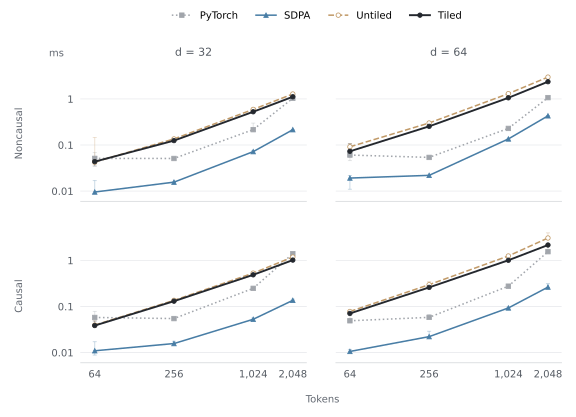

After reading the FlashAttention paper and [writing this summary](https://joshveergrewal.com/reading/flash-attention/), I built my way up to a basic implementation of its underlying forward-pass mechanism in PyTorch, then in Metal on my Mac.

## Standard attention

I first started off with standard attention, where I use the queries, keys, and values to calculate the scaled logits, softmax probabilities, and output. Below is the code from stdattention.py:

```python
def stdattention(Q, K, V):
    d = Q.shape[-1]
    S = (Q @ K.T)/math.sqrt(d)
    P = torch.softmax(S, dim=1)
    O = P @ V
    return S, P, O
```

Here, S and P both have shape (N, N), while O has shape (N, d). Each row of P sums to 1 and gives the weights for one query. Multiplying those weights by V gives the attention output.

## Online softmax

However, storing the full intermediate matrices quickly grows expensive as the sequence length increases. On the GPU, standard attention stores these intermediates in device memory but the whole matrix generally does not fit in small on-chip SRAM. So, as done in the paper, I need a running maximum and normalization sum that let me process scores incrementally. I started by writing a function for online softmax that returns probabilities:

```python
def onlinesoftmax(x, blockSize):
    l = x.new_tensor(0.0) # normalization sum
    m = x.new_tensor(float("-inf")) # largest score so far

    for start in range(0, x.numel(), blockSize):
        block = x[start:start + blockSize] # makes a slice
        m_new = torch.maximum(m, block.max())
        l = torch.exp(m - m_new) * l + torch.exp(block - m_new).sum() # rescaled sum from prev blocks and new block
        m = m_new
    return torch.exp(x - m)/l # attention prob
```

As I process blocks inside the for loop, I update m_new as needed and then calculate l, the normalization sum. The motivation behind deriving this expression is pretty interesting. If we split the scores into blocks, say [a, b] and [c, d], applying softmax separately to the first block would give exp(a)/(exp(a) + exp(b)). But this is incorrect for the full row because it ignores the second block.

Instead, we can accumulate the denominator across blocks:

$$
\ell_1 = e^a + e^b,\qquad \ell_2 = \ell_1 + e^c + e^d,\qquad p_a = \frac{e^a}{\ell_2}
$$
{: .math-display}

For numerical stability, we subtract the largest score seen so far, m, before exponentiating. This does not change the final probabilities because the same scaling factor appears in the numerator and denominator. Now ℓ is the sum of exp(xᵢ − m) over the scores processed so far.

For each iteration, I find the new maximum across the old scores and the current block. Updating ℓ then has two steps. First, rescale the accumulated sum so it uses the new maximum:

$$
e^{m-m_{\mathrm{new}}}\ell = e^{m-m_{\mathrm{new}}}\sum_{i\in\mathrm{old}}e^{x_i-m} = \sum_{i\in\mathrm{old}}e^{x_i-m_{\mathrm{new}}}
$$
{: .math-display}

Then add the new block on that same scale:

$$
\ell_{\mathrm{new}} = e^{m-m_{\mathrm{new}}}\ell + \sum_{i\,\in\,\mathrm{block}} e^{x_i-m_{\mathrm{new}}}
$$
{: .math-display}

Here, the sums run over previously processed scores and scores in the current block, respectively. Once all blocks are processed, torch.exp(x - m)/l returns the probabilities.

Notice, though, that this function still keeps and revisits x at the end. It shows how to accumulate the denominator, but by itself it does not let me discard every score block.

## One-query attention

We can improve on this for attention by introducing a variable that accumulates the weighted value vectors, allowing us to discard each score block after using it. I denote this variable as u. Then the core of onequeryattention.py is:

```python
def onequeryattention(Q, K, V, blockSize):
    d = Q.shape[-1]
    m = Q.new_tensor(float("-inf"))
    l = Q.new_tensor(0.0)
    u = V.new_zeros(V.shape[-1]) # unnormalized weighted sum of values

    for start in range(0, K.shape[0], blockSize):
        KBlock = K[start : start + blockSize]
        VBlock = V[start : start + blockSize]
        scores = (Q @ KBlock.T)/math.sqrt(d)
        m_new = torch.maximum(m, scores.max()) # raw scores instead of weights
        alpha = torch.exp(m - m_new)
        weights = torch.exp(scores - m_new)
        l = alpha * l + weights.sum() # accumulates the weights
        u = alpha * u + weights @ VBlock
        m = m_new
    return u/l
```

In this function, Q is one query vector. By iterating through blocks of keys and values for that query, I update u to store the unnormalized weighted sum of values. Once the loop completes, I can simply return u/l, which gives the final attention output instead of separate probabilities.

## Blockwise attention and causal masking

I extend this method to multiple query rows in blockwiseattention.py. For a block with B query rows, m and l each have shape (B, 1), and u has shape (B, d). Each query therefore keeps its own running statistics:

```python
            blockMax = scores.max(dim=1, keepdim=True).values # finds one max per row
            m_new = torch.maximum(m, blockMax)
            alpha = torch.exp(m - m_new)
            weights = torch.exp(scores - m_new)

            l = alpha * l + weights.sum(dim=1, keepdim=True)
            u = alpha * u + weights @ VBlock
            m = m_new
```

For each query block, I iterate through the key/value blocks and accumulate its output. After the inner loop, I save u/l to the corresponding rows of O and return O once all query blocks are finished. Using dim=1 gives a separate maximum and sum across the keys for each query and keepdim=True keeps the shapes compatible with row-by-row rescaling.

Another addition is causal masking, which prevents a query from attending to future keys during next-token prediction. This produces the lower-triangular matrix of allowed interactions. Before the softmax updates, I compare the query and key positions in the full sequence:

```python
            if causal:
                queryPositions = torch.arange(QStart, QStart + rows, device=Q.device).unsqueeze(1) # column
                keyPositions = torch.arange(KStart, KStart + KBlock.shape[0], device=K.device).unsqueeze(0) # row
                mask = keyPositions > queryPositions # creates a table of T/F values where each entry contains logical expression whether curr key is after curr query
                scores = scores.masked_fill(mask, float("-inf"))
```

The masked scores contribute zero after exponentiation. I also stop the key-block loop when KStart >= QStart + rows, because that block and every later block are entirely in the future for the current query block. This Python version checks the blockwise math.

## Moving to Metal

After coding this up, I decided to write fused GPU kernels: first an untiled version, then one with shared K/V tiles. I used Metal Shading Language (MSL) because I have an M-series Mac (and frankly couldn't get Triton running). The Python wrapper uses torch.mps.compile_shader to compile the MSL source and launch the kernel on the GPU with PyTorch tensors.

I have written CUDA before, so the structure wasn’t completely unfamiliar, but I was still surprised to see the C++-like syntax in Metal.

After declaring constants whose placeholders the Python wrapper fills in, I mark the attentionforward function with the keyword kernel and pass in the expected arguments. The thread_position_in_grid attribute supplies the global thread index, which I use as the query index:

```cpp
#include <metal_stdlib>
using namespace metal;

constant uint N = __N__; // number of tokens
constant uint D = __D__; // features per vector
constant bool CAUSAL = __CAUSAL__;

kernel void attentionforward(device const float* Q, device const float* K, device const float* V, device float* O, uint query[[thread_position_in_grid]]) {
```

The rest of attention.metal mostly translates the one-query PyTorch code into MSL, including causal masking and the weighted-value updates. Metal accesses the tensors as flat arrays, so Q[query * D + c] corresponds to Q[query, c]. The dot product is a loop over matching features:

```cpp
    float score = 0.0f;

    for (uint c = 0; c < D; ++c) score += Q[query * D + c] * K[key * D + c]; // equivalent to Q @ K
    score /= sqrt(float(D));
```

Unlike the Python function, this version processes one key at a time, so weight is a scalar. Each thread keeps its own m, l, and u. If causal masking is enabled, its key loop stops at query + 1. This fuses the forward computation, but different query threads still independently read the same K and V values.

## Shared-memory tiling

Although that translation was pretty straightforward, the shared-memory version took more thinking. In attentiontiled.metal, I set the tile size to 16 keys and the threadgroup size to 32 threads.

All threads within a threadgroup cooperate to load the same K/V tile, then reuse it while computing attention for their respective queries. Each thread loads a different subset of the tile’s elements. Even extra threads that do not have a valid query help load the current tile:

```cpp
    for (uint i = lane; i < TILE * D; i += THREADS) { // all threads in threadgroup load the same K/V tile to compute attention for its own query
      uint key = start + i/D;
      uint c = i % D;
      KTile[i] = key < N ? K[key * D + c] : 0.0f;
      VTile[i] = key < N ? V[key * D + c] : 0.0f;
    }
    threadgroup_barrier(mem_flags::mem_threadgroup); // synchronization to prevent RAW
```

Here, lane is the thread’s index within the group. With 32 threads, lane 0 loads elements 0, 32, 64, and so on, while lane 1 loads elements 1, 33, 65, and so on. Once the tile is loaded, each valid query thread processes its keys and updates its private m, l, and u. The Python wrapper rounds up to a full group of 32 threads and the query < N check prevents extra threads from writing an output.

To prevent read-after-write (RAW) and write-after-read (WAR) hazards, I use two threadgroup barriers. The first makes threads wait until loading is finished before reading the tile. The second makes them wait until everyone has finished reading before the next iteration overwrites it. All threads must reach both barriers, including the ones without a valid query.

One important change in index arithmetic is that key is a position in the full sequence, while j is a position within the shared tile. The tile reads therefore use KTile[j * D + c] and VTile[j * D + c]. Apart from where K and V are read, the online-softmax updates are the same, assigning one query per thread.

## Conclusion

The outputs matched the reference in the correctness tests, so I then compared performance on my Mac’s 10-core Apple M5 GPU using PyTorch 2.15.0. The benchmark used float32, one sequence and one head, with sequence lengths of 64, 256, 1,024, and 2,048, head dimensions of 32 and 64, and both causal and noncausal attention.



*Forward time in ms (log scale), FP32 on Apple M5. Median and min–max of seven batches.*

As you can see from the results, tiling usually helped my implementation: the tiled kernel had a lower median time than the untiled version in 15 of the 16 configurations. For 2,048 tokens with d = 64 and causal masking, the untiled kernel took 3.066 ms and the tiled version took 2.159 ms, a 1.42× speedup. However, explicit PyTorch attention took 1.548 ms, and PyTorch’s built-in scaled_dot_product_attention (SDPA) took 0.263 ms. SDPA was faster than both of my kernels in every tested configuration.

So the implementation was successful at reproducing the forward mechanism, but there still remains a substantial performance gap as expected. Some further work I would be interested in doing includes adding optimizations to close the gap between my current MSL fused GPU kernel and PyTorch, along with introducing backward-pass recomputation as done in the paper.

<p class="post-meta">Related: <a href="/reading/flash-attention/">My notes on FlashAttention</a></p>
