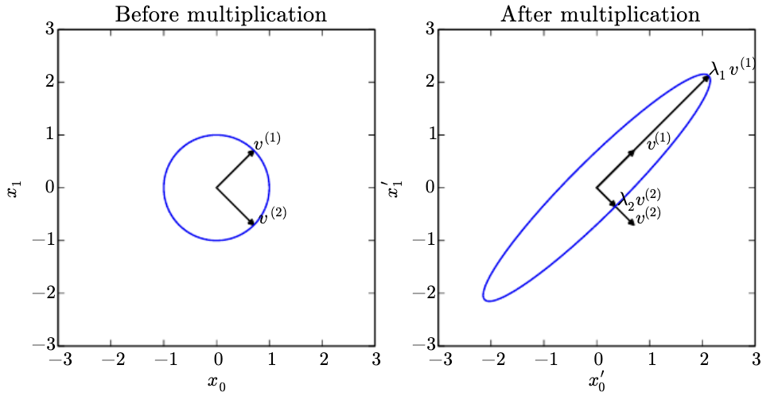
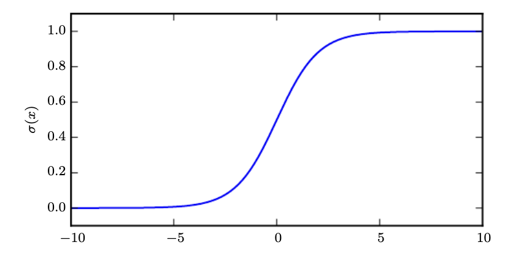
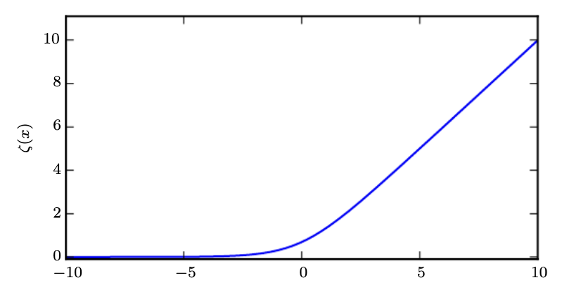

## Chapter 2 — Linear Algebra

[Chapter source](https://www.deeplearningbook.org/contents/linear_algebra.html)

### Matrices, spans, and inverses

For a matrix with $$m$$ rows and $$n$$ columns, $$A \in \mathbb{R}^{m \times n}$$. A tensor is a multidimensional array.

Transposing a matrix swaps its row and column indices: $$(A^{\mathrm{T}})_{i,j} = A_{j,i}$$. If a square matrix is invertible, $$A^{-1}A = I_n$$.

A span is the set of all linear combinations of some given vectors.

To determine whether $$Ax = b$$ has a solution, we need to check whether $$b$$ lies in the span of the columns of $$A$$. This is the column space, or range, of $$A$$. For every $$b \in \mathbb{R}^m$$ to have a solution, the columns must span $$\mathbb{R}^m$$. This requires $$n \geq m$$, but that condition alone is not enough: $$A$$ must have rank $$m$$.

A set of vectors is linearly independent if no vector in the set is a linear combination of the others. For a matrix to have an inverse, $$m = n$$ and all columns must be linearly independent. Otherwise, a square matrix is singular, meaning $$\det(A) = 0$$.

The system could still have a solution if the matrix is nonsquare or singular, but ordinary matrix inversion would not be a valid approach.

### Norms and orthogonality

We can measure the size of a vector using the $$L^p$$ norm:

$$
\Vert x\Vert _p = \left(\sum_i \vert x_i\vert ^p\right)^{1/p}, \qquad p \geq 1.
$$
{: .math-display}

At a high level, a norm gives a notion of distance from the origin to the point $$x$$.

$$L^1$$ gives Manhattan distance, measured along coordinate directions, while $$L^2$$ gives Euclidean distance. The $$L^2$$ norm is often squared because squaring is monotonically increasing for nonnegative inputs, so it preserves which vector has the smallest norm. It also gets rid of the square root and gives a simpler derivative in optimization problems.

$$L^\infty$$ is the max norm: $$\Vert x\Vert _\infty = \max_i \vert x_i\vert $$.

We can measure a matrix using the Frobenius norm, which flattens it into a vector and takes the $$L^2$$ norm:

$$
\Vert A\Vert _F = \sqrt{\sum_{i,j} A_{i,j}^2}.
$$
{: .math-display}

The dot-product identity is $$x \cdot y = x^{\mathrm{T}}y = \Vert x\Vert _2\Vert y\Vert _2\cos(\theta)$$.

Operations with diagonal matrices are computationally efficient. A symmetric matrix satisfies $$A = A^{\mathrm{T}}$$.

While computing a matrix inverse is expensive, an orthogonal matrix has orthonormal rows and columns: they are mutually orthogonal and have unit norm. Therefore:

$$
AA^{\mathrm{T}} = A^{\mathrm{T}}A = I, \qquad A^{-1} = A^{\mathrm{T}}.
$$
{: .math-display}

Because the inverse is just the transpose, this is very cheap.

### Eigendecomposition

An eigenvector of a square matrix $$A$$ is a nonzero vector $$v$$ such that multiplying by $$A$$ only scales it: $$Av = \lambda v$$, where $$\lambda$$ is a scalar. The input and output lie in the same vector space. Rearranging gives:

$$
Av = \lambda v \quad\Longrightarrow\quad (A-\lambda I)v = 0.
$$
{: .math-display}

For a nonzero $$v$$ to exist, $$A-\lambda I$$ must be singular, so we solve $$\det(A-\lambda I) = 0$$ for the eigenvalues and then find their eigenvectors. A matrix in $$\mathbb{R}^{n \times n}$$ can have at most $$n$$ linearly independent eigenvectors. It can have infinitely many eigenvectors because nonzero scalar multiples of an eigenvector are also eigenvectors.

Now suppose $$A$$ has $$n$$ linearly independent eigenvectors, and we form $$V$$ by stacking them as columns. Then:

$$
AV = [\lambda_1v^{(1)},\lambda_2v^{(2)},\dots,\lambda_nv^{(n)}].
$$
{: .math-display}

For example, if $$\lambda_1 = a$$ and $$\lambda_2 = b$$, then $$\operatorname{diag}(\lambda) = \begin{bmatrix}a & 0 \\ 0 & b\end{bmatrix}$$.

Interestingly, due to the nature of diagonal matrix multiplication, the scaled columns above are exactly $$V\operatorname{diag}(\lambda)$$. So:

$$
AV = V\operatorname{diag}(\lambda), \qquad A = V\operatorname{diag}(\lambda)V^{-1}.
$$
{: .math-display}

We can multiply by $$V^{-1}$$ because the columns of $$V$$ are linearly independent. This decomposition requires $$A$$ to be diagonalizable; not every square matrix is.

Every real symmetric matrix has a decomposition using real eigenvalues and an orthonormal basis of eigenvectors: $$A = Q\Lambda Q^{\mathrm{T}}$$.

Even with distinct eigenvalues, eigenvectors are not completely unique: their scale and ordering can change. With normalized real eigenvectors, their signs can still change. Repeated eigenvalues also allow different bases within the same eigenspace. A square matrix is singular if and only if at least one eigenvalue is zero.

### Singular value decomposition and the pseudoinverse

Singular value decomposition (SVD) is another way to factor a matrix. Unlike eigendecomposition, it also applies to nonsquare matrices.

For $$A \in \mathbb{R}^{m \times n}$$, the full SVD is:

$$
A = UDV^{\mathrm{T}}, \qquad U \in \mathbb{R}^{m \times m},\quad D \in \mathbb{R}^{m \times n},\quad V \in \mathbb{R}^{n \times n}.
$$
{: .math-display}

$$U$$ and $$V$$ are orthogonal matrices, while $$D$$ is a rectangular diagonal matrix. The diagonal entries of $$D$$ are the singular values of $$A$$. The columns of $$U$$ are the left singular vectors, and the columns of $$V$$ are the right singular vectors.

We can generalize the inverse of a nonsquare or singular matrix using the Moore–Penrose pseudoinverse:

$$
A^+ = VD^+U^{\mathrm{T}}.
$$
{: .math-display}

Here, $$D^+$$ has shape $$n \times m$$: transpose the rectangular diagonal matrix and replace each nonzero singular value with its reciprocal. Zero entries remain zero. This gives a least-squares solution, choosing the minimum-norm solution when there is more than one.

The trace is the sum of the diagonal entries of a square matrix: $$\operatorname{Tr}(A) = \sum_i A_{i,i}$$. For compatible matrix products, trace is unchanged by cyclic permutation, such as $$\operatorname{Tr}(ABC) = \operatorname{Tr}(BCA)$$.

This also lets us write the Frobenius norm as $$\Vert A\Vert _F = \sqrt{\operatorname{Tr}(AA^{\mathrm{T}})}$$.

The determinant of a square matrix is the product of its eigenvalues. Its absolute value tells us how the transformation scales volume; its sign records whether orientation is reversed.

### PCA as compression

Suppose we have $$m$$ data points with $$n$$ features, so each $$x^{(i)} \in \mathbb{R}^n$$. We want to map each point into $$\mathbb{R}^l$$, where $$l < n$$, which gives lossy compression. We need an encoder $$f(x) = c$$ and a decoder $$g(c) \approx x$$.

With PCA, we use the linear decoder $$g(c) = Dc$$, where $$D \in \mathbb{R}^{n \times l}$$. This makes sense because $$c \in \mathbb{R}^l$$, so multiplying by $$D$$ returns us to $$\mathbb{R}^n$$. We constrain the columns of $$D$$ to be orthonormal, which makes the encoding simple and avoids arbitrary rescaling of the code. Full column rank is enough for the least-squares code to be unique.

For centered data, the practical application boils down to two optimization problems:

1. Fix $$D$$ and find the code that minimizes reconstruction error: $$c^* = \operatorname*{arg\,min}_c \Vert x-Dc\Vert _2^2$$. With orthonormal columns, $$c^* = D^{\mathrm{T}}x$$.
2. Find the optimal $$D$$ by minimizing reconstruction error over all points, which can be expressed using the Frobenius norm.

## Chapter 3 — Probability and Information Theory

[Chapter source](https://www.deeplearningbook.org/contents/prob.html)

### Uncertainty and distributions

There are three possible sources of uncertainty:

1. Inherent stochasticity in the modeled system.
2. Incomplete observability.
3. Incomplete modeling.

A random variable can be discrete or continuous. A probability mass function (PMF) describes a distribution over discrete random variables. A joint distribution gives probabilities such as $$P(X=x,Y=y)$$, often abbreviated as $$P(x,y)$$.

A probability density function (PDF) describes a distribution over continuous random variables. For a small interval of width $$\delta x$$, its probability is approximately $$p(x)\delta x$$. The probability that $$X$$ lies in $$[a,b]$$ is:

$$
P(a \leq X \leq b) = \int_a^b p(x)\,dx.
$$
{: .math-display}

Two random variables $$X$$ and $$Y$$ are independent if their joint distribution factors as $$p(x,y)=p(x)p(y)$$. They are conditionally independent given $$Z$$ if $$p(x,y\mid z)=p(x\mid z)p(y\mid z)$$ for the relevant values of $$z$$.

The binomial distribution describes the sum of independent Bernoulli trials with the same success probability. Each trial has a binary outcome. The normal distribution over real numbers is also called the Gaussian distribution.

Under the usual i.i.d. assumptions with finite, nonzero variance, the central limit theorem says that a centered and appropriately scaled sum approaches a normal distribution as the number of terms grows. A Gaussian also has maximum differential entropy among distributions with a fixed mean and variance, so it introduces the least additional assumptions under those constraints.

For a multivariate Gaussian, we can parameterize using the precision matrix $$\beta = \Sigma^{-1}$$ instead of the covariance matrix $$\Sigma$$. This can be useful when the inverse covariance is the quantity needed in the calculation.

### Exponential, Laplace, and empirical distributions

For nonnegative quantities, the exponential distribution places its highest density at zero:

$$
p(x;\lambda) = \lambda\mathbf{1}_{x\geq 0}e^{-\lambda x}, \qquad \lambda > 0.
$$
{: .math-display}

The indicator $$\mathbf{1}_{x\geq 0}$$ assigns zero density to negative values. The negative log-density grows linearly with $$x$$ on its support, so equal increases in $$x$$ incur equal increases in the penalty—not equal penalties for all errors.

The Laplace distribution allows us to place a sharp peak at an arbitrary point $$\mu$$:

$$
p(x;\mu,\gamma) = \frac{1}{2\gamma}\exp\left(-\frac{\vert x-\mu\vert }{\gamma}\right), \qquad \gamma > 0.
$$
{: .math-display}

We can use the Dirac delta to put all probability mass at a single point: $$p(x)=\delta(x-\mu)$$. The distribution is concentrated at $$x=\mu$$ and integrates to 1. It is a generalized function defined through its integration properties, rather than an ordinary finite-valued density.

Suppose we have $$m$$ observed points and want to assign mass $$1/m$$ to each observation. For continuous variables, we can use Dirac deltas to write the empirical distribution:

$$
\hat p(x) = \frac{1}{m}\sum_{i=1}^m \delta(x-x^{(i)}).
$$
{: .math-display}

Each spike contributes mass $$1/m$$, so the distribution integrates to 1. An ordinary finite density at a single point would contribute no probability mass.

### Mixtures and latent variables

A mixture distribution consists of multiple component distributions. A component identity $$C$$ determines which distribution is selected:

$$
p(x) = \sum_i P(C=i)p(x\mid C=i).
$$
{: .math-display}

$$P(C)$$ is a multinoulli, or categorical, distribution over component identities. A latent variable is a random variable we cannot observe directly, such as $$C$$ above.

A Gaussian mixture model (GMM) is a weighted sum of $$K$$ Gaussians. Each component has its own mean $$\mu^{(i)}$$, covariance $$\Sigma^{(i)}$$, and weight $$\alpha_i=P(C=i)$$.

The weight $$\alpha_i$$ is the prior probability of selecting component $$i$$, before observing $$x$$. After observing $$x$$, we can calculate the posterior $$P(C=i\mid x)$$ using the same model. With enough components, GMMs can approximate a broad class of smooth densities arbitrarily closely under suitable approximation criteria.

### Sigmoid and softplus

The logistic sigmoid is $$\sigma(x)=1/(1+e^{-x})$$. It is commonly used to produce the probability parameter $$\phi$$ of a Bernoulli distribution because its range is $$(0,1)$$. It saturates when $$x$$ is very positive or negative.

The softplus function is $$\zeta(x)=\log(1+e^x)$$. Its range is $$(0,\infty)$$, so it can produce positive parameters such as a Gaussian’s standard deviation or a scalar precision parameter.

Softplus is a smoothed version of ReLU, $$x^+=\max(0,x)$$. This is the positive-part function, while the negative-part function is $$x^-=\max(0,-x)$$. Softplus satisfies $$\zeta(x)-\zeta(-x)=x$$, and $$\zeta(-x)=\log(1+e^{-x})$$ is a smooth version of the negative part.

### Bayes’ rule, measures, and changes of variables

Bayes’ rule is $$P(x\mid y)=P(x)P(y\mid x)/P(y)$$, provided $$P(y)>0$$.

Measure theory gives a precise way to define probabilities and volumes. We cannot assign a consistent, translation-invariant volume to every possible subset of Euclidean space while keeping the usual additivity properties. Distinguishing measurable from nonmeasurable sets avoids contradictions such as those illustrated by Vitali sets. For disjoint measurable sets, probabilities do add correctly.

A set of measure zero occupies no volume under the measure we are using. A property holds almost everywhere if it holds except on a set of measure zero.

Suppose $$Y=g(X)$$, where $$g$$ is differentiable and invertible. We might expect $$p_Y(y)=p_X(g^{-1}(y))$$, but that misses how $$g$$ stretches or compresses space. Probability mass must be preserved: $$p_Y(y)\vert dy\vert =p_X(x)\vert dx\vert $$. Therefore:

$$
p_Y(y) = p_X(g^{-1}(y))\left\vert \frac{dx}{dy}\right\vert .
$$
{: .math-display}

The derivative is the correction factor. In higher dimensions, the corresponding formula uses the determinant of the Jacobian:

$$
p_X(x) = p_Y(g(x))\left\vert \det\left(\frac{\partial g(x)}{\partial x}\right)\right\vert .
$$
{: .math-display}

### Information and graphical models

The self-information of an event $$X=x$$ is $$I(x)=-\log P(x)$$. Using natural logarithms, observing an event with probability $$1/e$$ gives one nat of information.

Shannon entropy quantifies uncertainty across a discrete distribution:

$$
H(X) = \mathbb{E}_{X\sim P}[I(X)] = -\mathbb{E}_{X\sim P}[\log P(X)].
$$
{: .math-display}

It is the expected information from an observation drawn from that distribution. The analogous quantity for a continuous variable is differential entropy, defined using its density; it does not share every property of discrete entropy.

Kullback–Leibler (KL) divergence measures the discrepancy between distributions $$P$$ and $$Q$$:

$$
D_{\mathrm{KL}}(P\Vert Q) = \mathbb{E}_{X\sim P}\left[\log\frac{P(X)}{Q(X)}\right].
$$
{: .math-display}

For a fixed $$P$$, minimizing cross-entropy with respect to $$Q$$ is equivalent to minimizing KL divergence, because $$H(P,Q)=H(P)+D_{\mathrm{KL}}(P\Vert Q)$$, where:

$$
H(P,Q) = -\mathbb{E}_{X\sim P}[\log Q(X)].
$$
{: .math-display}

A structured probabilistic model uses a graph to describe the factorization of a distribution. Each node represents a random variable, and edges encode direct relationships in that factorization; an edge is not itself a probability distribution.

A directed model, or Bayesian network, contains one conditional factor per variable, given its parents:

$$
p(x) = \prod_i p(x_i\mid \operatorname{Pa}_G(x_i)).
$$
{: .math-display}

An undirected model, or Markov random field, uses nonnegative factors over cliques—sets of nodes that are all connected to each other. For clique $$C^{(i)}$$, let its factor be $$\phi^{(i)}(x_{C^{(i)}})$$. Then:

$$
p(x) = \frac{1}{Z}\prod_i \phi^{(i)}(x_{C^{(i)}}).
$$
{: .math-display}

The normalizing constant $$Z$$ makes the distribution sum or integrate to 1.

## Chapter 5 — Machine Learning Basics

[Chapter source](https://www.deeplearningbook.org/contents/ml.html)

### Tasks, data, and generalization

An example is a collection of features measured from some object or event. We can represent it as $$x\in\mathbb{R}^n$$, where each entry $$x_i$$ is a feature.

Classification specifies which of $$k$$ categories the input belongs to. The model produces a function $$f:\mathbb{R}^n\rightarrow\{1,\dots,k\}$$, and $$y=f(x)$$ assigns the input to a category. If some features are missing, the model needs a way to handle different subsets of observed inputs, potentially through different functions or a shared missing-data mechanism.

Regression produces a real-valued output, such as $$f:\mathbb{R}^n\rightarrow\mathbb{R}$$.

For classification, error rate measures incorrect class decisions. Other losses can evaluate predicted probabilities or soft targets. Learning experiences can be supervised, with labels, or unsupervised.

A dataset can be represented as a design matrix, where each row is an example and each column is a feature.

Linear regression predicts $$\hat y=w^{\mathrm{T}}x$$, where $$w\in\mathbb{R}^n$$ contains the weights determining how each feature affects the prediction. We can also introduce a bias parameter $$b$$.

In ML, we want both training error and test, or generalization, error to be low. Under the i.i.d. assumption, examples are sampled independently from the same data-generating distribution.

For a model chosen independently of the sampled datasets, expected training and test error are the same under these assumptions. Once the model is fitted to the training data, this argument no longer applies: the training error is generally optimistic.

Bayes error is the minimum achievable expected classification error when the true distribution $$p(x,y)$$ is known. Irreducible uncertainty can arise because the mapping from $$x$$ to $$y$$ is stochastic, or because relevant variables are missing from $$x$$.

### Regularization and validation

Suppose we modify linear regression by adding weight decay:

$$
J(w)=\operatorname{MSE}_{\mathrm{train}}+\lambda w^{\mathrm{T}}w.
$$
{: .math-display}

The first term measures how well the model fits the training data, while the second expresses a preference for smaller weights. The parameter $$\lambda$$ controls the tradeoff between fitting the data and keeping the weights small.

Regularization modifies a learning algorithm with the aim of reducing generalization error, potentially at the cost of higher training error. In this example, the regularizer is $$\Omega(w)=w^{\mathrm{T}}w$$.

To choose hyperparameters, we use a validation set, often held out from the available training data. Ergo, we have disjoint subsets: one to learn the parameters and another to estimate performance when choosing settings. The test set remains separate for the final evaluation.

### Estimators, bias, and variance

Let $$\{x^{(1)},\dots,x^{(m)}\}$$ be $$m$$ i.i.d. observations. A point estimator is a function of the data used to estimate a parameter:

$$
\hat\theta_m=g(x^{(1)},\dots,x^{(m)}).
$$
{: .math-display}

Its bias is $$\operatorname{bias}(\hat\theta_m)=\mathbb{E}[\hat\theta_m]-\theta$$. The estimator is unbiased when this equals zero, meaning $$\mathbb{E}[\hat\theta_m]=\theta$$.

Bias measures how far the estimator’s expected value is from the true parameter. Variance measures how much its value changes around that expectation across different samples of the data.

For a scalar parameter, MSE combines both:

$$
\mathbb{E}[(\hat\theta_m-\theta)^2]=\operatorname{bias}(\hat\theta_m)^2+\operatorname{Var}(\hat\theta_m).
$$
{: .math-display}

Increasing model capacity often decreases bias and increases variance in the classical bias–variance picture, though this is not a universal rule for every learning setup.

Consistency means $$\hat\theta_m\xrightarrow{p}\theta$$ as $$m\rightarrow\infty$$: the estimator converges in probability to the true parameter.

### Maximum likelihood estimation

Maximum likelihood estimation (MLE) chooses the parameters of a probability distribution that best explain the observed data in terms of likelihood.

Suppose we have $$m$$ i.i.d. examples $$\mathcal{X}=\{x^{(1)},\dots,x^{(m)}\}$$ from an unknown distribution $$p_{\mathrm{data}}$$. We fit a parametric family $$p_{\mathrm{model}}(x;\theta)$$ to these observations. Under suitable regularity conditions, MLE is consistent and asymptotically efficient. Two important requirements for recovering the true parameter are:

1. The true distribution belongs to the model family. Otherwise, no parameter in that family can represent it exactly.
2. Different parameter values identify different distributions. Otherwise, even recovering the distribution would not identify a unique parameter value.

MLE is defined as:

$$
\hat\theta_{\mathrm{ML}}=\operatorname*{arg\,max}_\theta p_{\mathrm{model}}(\mathcal{X};\theta)=\operatorname*{arg\,max}_\theta\prod_{i=1}^m p_{\mathrm{model}}(x^{(i)};\theta).
$$
{: .math-display}

Multiplying many small probabilities can cause numerical underflow. Taking the logarithm gives an equivalent optimization problem and turns the product into a sum:

$$
\hat\theta_{\mathrm{ML}}=\operatorname*{arg\,max}_\theta\sum_{i=1}^m\log p_{\mathrm{model}}(x^{(i)};\theta).
$$
{: .math-display}

Another way to interpret this is minimizing the empirical average negative log-likelihood. For discrete distributions, this is equivalent to minimizing KL divergence from the empirical distribution:

$$
D_{\mathrm{KL}}(\hat p_{\mathrm{data}}\Vert p_{\mathrm{model}})=\mathbb{E}_{X\sim\hat p_{\mathrm{data}}}[\log\hat p_{\mathrm{data}}(X)-\log p_{\mathrm{model}}(X;\theta)].
$$
{: .math-display}

The first term does not depend on $$\theta$$. For continuous data represented by Dirac spikes, the literal KL divergence to a smooth density needs care; the empirical negative log-likelihood objective is still well defined when the model density is positive at the observations.

For conditional MLE, using independent examples:

$$
\hat\theta_{\mathrm{ML}}=\operatorname*{arg\,max}_\theta p(Y\mid X;\theta)=\operatorname*{arg\,max}_\theta\sum_{i=1}^m\log p_{\mathrm{model}}(y^{(i)}\mid x^{(i)};\theta).
$$
{: .math-display}

Consistent estimators can differ in statistical efficiency: with a fixed number of observations, one may estimate the parameter with less variance than another. Consistency alone does not guarantee good finite-sample performance.

### Bayesian estimation and MAP

In the point-estimation approach, we estimate one value of $$\theta$$ and use it to make predictions. Bayesian prediction instead averages over a posterior distribution of possible parameter values.

Bayesian statistics uses probability to reflect uncertainty about $$\theta$$. We condition on the observed dataset and represent our prior knowledge using $$p(\theta)$$. A broad prior can express substantial uncertainty; for example, we might use a uniform distribution over a finite range.

After observing $$\mathcal{X}$$, Bayes’ rule gives:

$$
p(\theta\mid\mathcal{X})=\frac{p(\mathcal{X}\mid\theta)p(\theta)}{p(\mathcal{X})}.
$$
{: .math-display}

With informative data, the posterior often concentrates around plausible parameter values, though observing a particular dataset does not guarantee that entropy decreases.

There are two main differences from the MLE point-estimate approach:

1. Bayesian prediction uses the posterior distribution over $$\theta$$, rather than only one estimate. For a new observation:

$$
p(x^{(m+1)}\mid\mathcal{X})=\int p(x^{(m+1)}\mid\theta)p(\theta\mid\mathcal{X})\,d\theta.
$$
{: .math-display}

   Parameter values contribute according to their posterior density, so remaining uncertainty about $$\theta$$ affects the prediction.

2. The prior expresses preferences before seeing the data. It can favor simpler or smoother models, depending on how it is chosen.
{:start="2"}

Maximum a posteriori (MAP) estimation chooses a point that maximizes the posterior density:

$$
\hat\theta_{\mathrm{MAP}}=\operatorname*{arg\,max}_\theta p(\theta\mid\mathcal{X})=\operatorname*{arg\,max}_\theta\left[\log p(\mathcal{X}\mid\theta)+\log p(\theta)\right].
$$
{: .math-display}

On the right, the first term is the log-likelihood and the second is the log-prior. When minimizing the negative log-posterior, the negative log-prior acts as a regularization term. The prior brings in information not contained in the training data. This can reduce variance while introducing bias compared with MLE.

### Linear and logistic regression

Many supervised learning algorithms estimate $$p(y\mid x)$$ by fitting a parametric family $$p(y\mid x;\theta)$$ with MLE. So we are fitting a probability distribution to the data, rather than just predicting a single number.

For example, scalar linear regression with unit noise variance corresponds to $$p(y\mid x;\theta)=\mathcal{N}(y;\theta^{\mathrm{T}}x,1)$$.

Now suppose we turn this into binary classification, where $$y$$ is 0 or 1. We only need to specify the probability of one class, since the two probabilities must sum to 1. We can run the linear score through a sigmoid to map it from the real numbers into $$(0,1)$$:

$$
p(y=1\mid x;\theta)=\sigma(\theta^{\mathrm{T}}x).
$$
{: .math-display}

This is logistic regression. For ordinary least-squares linear regression, $$\hat\theta=(X^{\mathrm{T}}X)^{-1}X^{\mathrm{T}}y$$ when $$X$$ has full column rank. Logistic regression generally has no closed-form solution, so we optimize the log-likelihood numerically—for example, by minimizing negative log-likelihood with gradient descent.

### SVMs and the kernel trick

Support vector machines (SVMs) are similar to logistic regression in that both can use the linear score $$w^{\mathrm{T}}x+b$$. Logistic regression maps that score to a probability, while an SVM uses its sign for the class prediction. In the usual soft-margin SVM, points on or inside the margin, including misclassified points, determine the hinge-loss penalty. Logistic regression uses a different loss, rather than simply trying to fit every point exactly.

SVMs can use the kernel trick, which relies on writing the decision function in terms of inner products between examples:

$$
w^{\mathrm{T}}x+b=b+\sum_{i=1}^m\alpha_i x^{\mathrm{T}}x^{(i)}, \qquad f(x)=b+\sum_i\alpha_i k(x,x^{(i)}).
$$
{: .math-display}

Here, the coefficients can absorb the class-label factors. Rewriting the function this way lets us replace the dot product with $$k(x,x^{(i)})=\langle\phi(x),\phi(x^{(i)})\rangle$$, where $$\phi$$ is a feature transformation. This gives us a comparison between two points as if they were in a richer space, without necessarily constructing their transformed vectors.

The angle brackets denote an inner product. Infinite-dimensional feature spaces can still have well-defined inner products, even when explicitly constructing the feature vectors is impractical.

The kernel trick is useful for two reasons:

1. For models such as SVMs, fixing a suitable kernel lets us learn nonlinear functions of $$x$$ through a convex optimization problem. The feature transformation is fixed while the coefficients are optimized.
2. Evaluating $$k(x,x^{(i)})$$ can be much more computationally efficient than constructing both feature vectors and taking their inner product.

For nonnegative scalar inputs, $$k(x,z)=\min(x,z)$$ is an example of an inner product in an infinite-dimensional feature space. Taking $$\phi_x(t)=\mathbf{1}_{0\leq t\leq x}$$ gives $$\int_0^\infty\phi_x(t)\phi_z(t)\,dt=\min(x,z)$$.

A common Gaussian, or radial basis function (RBF), kernel is:

$$
k(u,v)=\exp\left(-\frac{\Vert u-v\Vert _2^2}{2\sigma^2}\right).
$$
{: .math-display}

It approaches zero as the points become far apart. This acts like template matching: a training example can serve as a template that contributes to predictions for nearby inputs.

Kernel methods can be expensive because evaluating the decision function involves the retained training examples, or support vectors. Their cost can grow linearly with the number of those examples. They do not inherently generalize poorly, but fixed similarity functions can limit how effectively they generalize away from the training data.

### Unsupervised representations and optimization

Three common goals for simpler representations are lower dimensionality, sparsity, and independence.

PCA learns a linear representation along directions of greatest variance and can reduce dimensionality. Its components are uncorrelated, but not generally independent. The transformation $$W$$ maps input data $$x$$ to a representation $$z$$; this need not recover the underlying independent factors of variation.

$$k$$-means clustering divides the training examples into $$k$$ clusters. A cluster assignment can be represented by a $$k$$-dimensional one-hot vector $$h$$: if $$x$$ belongs to cluster $$i$$, then $$h_i=1$$ and the other entries are zero. This is an extreme example of a sparse representation.

The algorithm initializes $$k$$ centroids $$\{\mu^{(1)},\dots,\mu^{(k)}\}$$ and alternates between two steps until convergence:

1. Assign each example to its nearest centroid.
2. Update each centroid to the mean of the examples assigned to it.

A cost function often decomposes into an average of per-example losses. For example, negative conditional log-likelihood can be written as:

$$
J(\theta)=\mathbb{E}_{(X,Y)\sim\hat p_{\mathrm{data}}}[L(X,Y,\theta)]=\frac{1}{m}\sum_{i=1}^m L(x^{(i)},y^{(i)},\theta).
$$
{: .math-display}

Stochastic gradient descent (SGD) applies to linear models and deep networks. It samples a minibatch $$\mathcal{B}$$ of size $$m'$$ from a training set of size $$m$$. The minibatch size can remain fixed as the dataset grows. We estimate the gradient using:

$$
g=\frac{1}{m'}\sum_{i\in\mathcal{B}}\nabla_\theta L(x^{(i)},y^{(i)},\theta).
$$
{: .math-display}

Then we update $$\theta\leftarrow\theta-\epsilon g$$, where $$\epsilon$$ is the learning rate. The gradient points in the direction of the steepest local increase in the minibatch loss, so stepping in the opposite direction aims to reduce it. For nonconvex problems, this does not guarantee globally optimal weights.

An ML learning procedure includes a dataset, a cost function, a model, and an optimization procedure. Some models need special-purpose optimization methods when their objectives are poorly suited to ordinary gradient-based methods, such as objectives with flat regions.

For example, linear regression combines data $$X,y$$, a Gaussian model $$p(y\mid x)=\mathcal{N}(y;x^{\mathrm{T}}w+b,1)$$, and the cost $$J(w,b)=-\mathbb{E}_{(X,Y)\sim\hat p_{\mathrm{data}}}[\log p(Y\mid X)]$$. Its optimizer can solve the normal equations obtained by setting the gradient to zero.
